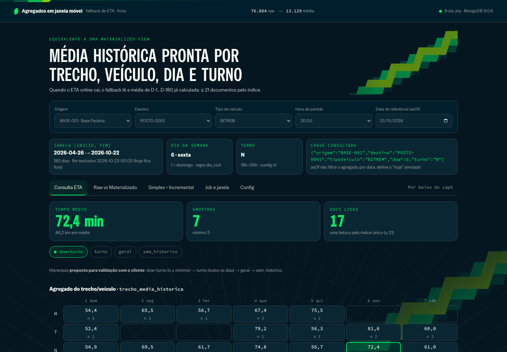
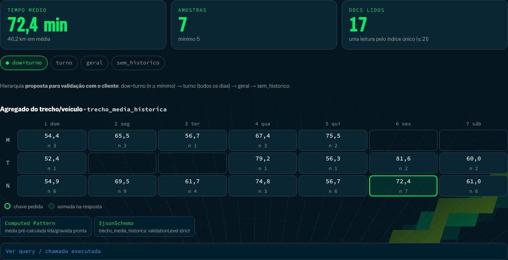
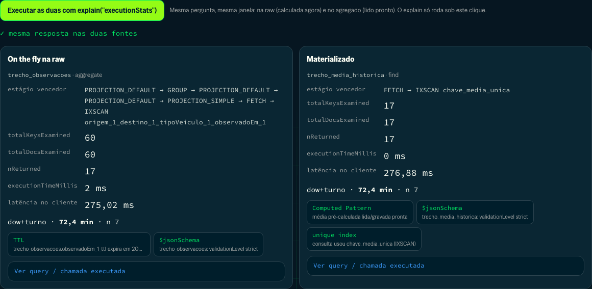
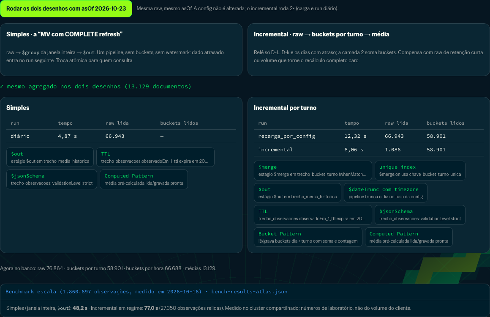
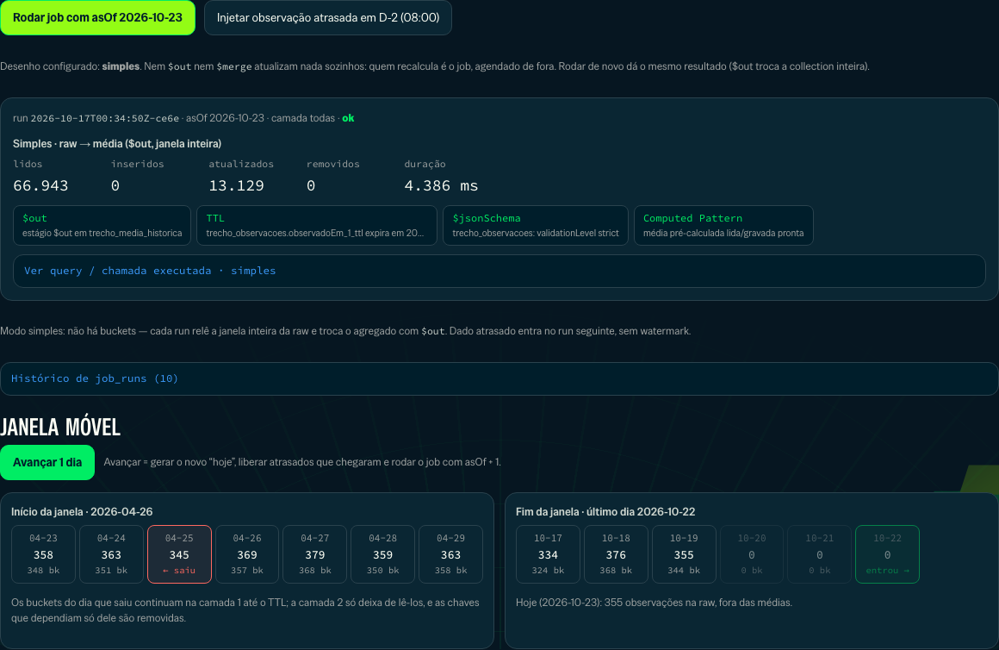
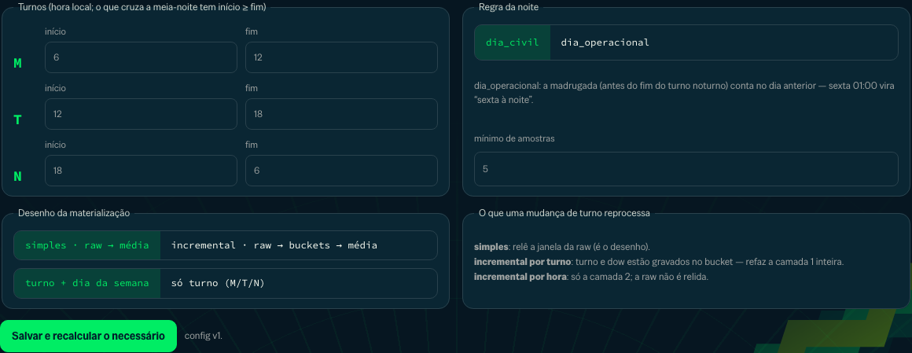
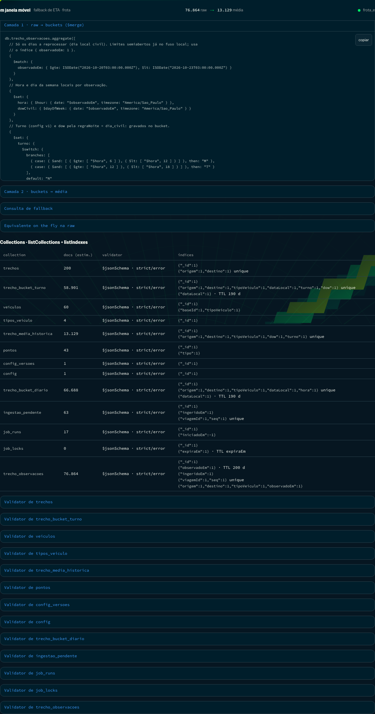
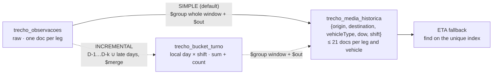

# Rolling-window aggregates on MongoDB — offline ETA fallback for a fleet

An executable proof of value for one question: **how do raw trip-leg records become
pre-computed averages, queryable in milliseconds by origin, destination, vehicle type and
period of the day (morning / afternoon / night), without computing anything at ETA time?**
The window is **D-1 to D-180**; today is always excluded. Day of the week is an optional
extension.



> All data is synthetic (a generic fuel distributor with a fleet). **The data model
> demonstrates the pattern; it is not a production schema proposal.** No customer name,
> cluster hostname or connection string is in this repository.

## The demonstration

### 1 · Ask for an ETA when the online service is down

Pick origin, destination, vehicle type and departure hour; the reference date (`asOf`)
defines the simulated "today". The screen shows what that date derives — the half-open
window `[D-180, today)`, the day of the week (1 = Sunday) and the shift with its limits —
and the exact key read: `{origin, destination, vehicleType, dow: 6, shift: "N"}`.

The answer comes from **one `find` on a unique index, at most 21 documents** (7 days ×
3 shifts). The grid under the result is that read: every day/shift combination for the
leg, with the requested cell outlined and the cells summed into the answer shaded.



When the specific cell has too few samples, the answer steps down — `dow+shift` →
`shift` (all days) → `overall` → `no_history` — and says which level it used. That
hierarchy is a **proposal to validate with the customer**. Rolling up is only correct
because the aggregate keeps `sum` and `count`, not just the mean.

### 2 · Same question, raw versus materialized, with the real `explain`



The same window and question are answered from the raw collection (computed now) and from
the aggregate (read ready). Both columns come from `explain("executionStats")`, run only
when the presenter clicks.

### 3 · Two designs, one result



| | **Simple** (default) | **Incremental** (option for scale) |
|---|---|---|
| Flow | raw → `$group` over the whole window → `$out` | raw → buckets per **shift** (or hour) → `$out` |
| Oracle equivalent | MV with a scheduled COMPLETE refresh | MV with fast refresh |
| Late data | picked up by the next run (each run re-reads 180 days) | D-1…D-k plus an `ingestedAt` watermark |
| Changing shift limits | the next run applies them | shift grain rebuilds layer 1; hour grain recomputes layer 2 only |
| Raw retention | ≥ 181 days | can be short; buckets carry the history |

Both produce **exactly the same aggregate** — tested on hand-built fixtures and on
synthetic data, with the `civil_day` and `operational_day` night rules, with and without
day of week, and switching design and grain across days (`tests/test_modos.py`). The tab
runs both over the same raw data and compares them live.

**Recommendation: start with the simple design.** It is one pipeline, idempotent by nature
(`$out` swaps the collection atomically and keeps its indexes and validator), and it was
the fastest in the benchmark. The incremental design earns its place when raw retention
must be short, or when re-reading 180 days every day becomes expensive.

### 4 · The job, late data and the moving window



`$out` and `$merge` refresh nothing by themselves: a scheduled job does. The tab runs it
with any `asOf`, injects a late observation two days back, re-runs it (the correction
appears; a third run changes nothing) and advances the simulated clock one day, showing
the day that entered, the day that left and the aggregates removed.

### 5 · Change the business rule



Shift limits, the night rule (does Friday 01:00 count as Friday night?), the minimum
sample count, the design, the bucket grain and whether day of week is part of the key live
in one versioned `config` document. Saving reports exactly what was re-read. The fallback
derives its key with the config version that produced the aggregate, so a change that has
not been materialized yet cannot mix new shifts with old averages.

### 6 · Under the hood



Every pipeline is shown exactly as sent to the driver, commented stage by stage and ready
for `mongosh`. Validators, indexes and TTLs are read from `listCollections` and
`listIndexes`. Feature badges (`$merge`, `$out`, Bucket Pattern, Computed Pattern,
`$dateTrunc` with timezone, unique index, TTL, `$jsonSchema`) are derived from the stages
and indexes actually used by the operation on screen.

## Architecture



- All dates are BSON `Date` in UTC. "Day", "hour" and "day of week" are interpreted in
  `America/Sao_Paulo` inside the pipeline (`$dateTrunc`, `$hour`, `$dayOfWeek` with
  `timezone`), never from date strings.
- The window is **half-open** and computed from `asOf` as a parameter — never `$$NOW` or
  the system clock — so its edges are testable and the window can be moved: 00:00:00.000 of
  D-180 enters, 23:59:59.999 of D-181 leaves, 23:59:59.999 of D-1 enters, 00:00:00.000 of
  today leaves.
- "Every Friday night" is the key `{dow: 6, shift: "N"}`. The key has **no date**, so it
  combines every eligible Friday in the window.
- Every collection is created with a `$jsonSchema` validator (`strict`, `error`); a date
  sent as a string is rejected.

Data model, index-by-index justification, retention trade-offs, the time series
alternative and operator compatibility are in [`docs/visao-tecnica.md`](docs/visao-tecnica.md)
(Portuguese).

### Equivalent to an Oracle materialized view

| | Oracle MV | This PoV |
|---|---|---|
| Materialized result | MV segment | `trecho_media_historica` collection |
| Who refreshes it | `DBMS_MVIEW.REFRESH` / scheduler job | application job (`jobs/materializar.py`) called by a scheduler |
| Window relative to today | the query would use `SYSDATE`; non-repeatable expressions like `SYSDATE` make the MV **ineligible for fast refresh**, so it would be a scheduled COMPLETE refresh | `asOf` is a **parameter**; the limits reach the pipeline already computed |
| Complete refresh | `COMPLETE` | **simple** design: `$group` + `$out` |
| Incremental refresh | fast refresh needs an MV log and an eligible query | **incremental** design: buckets for k days plus late days |
| New database object | table/MV plus DDL approval | collections in the MongoDB already in the solution; no new adapter |

The comparison is architectural, not a performance claim: Oracle was not measured.

## Measured results

### Tests

The same suite runs against both targets. On 2026-10-16:

| Target | Version | Result |
|---|---|---|
| MongoDB Atlas, shared portfolio cluster (M30, AWS São Paulo) | **9.0.4** | **109 passed** in 32 min (the duration is network: ~260 ms per round trip from the test machine) |
| Local Docker, single-node replica set | **8.0.34** | **109 passed** in 12 s |
| Acceptance from an empty volume: `make up && make seed PROFILE=small && make job && make test` | 8.0.34 | passed |

| File | Tests | Covers |
|---|---:|---|
| `test_camada1.py` | 7 | buckets by local day and hour, timezone (23:30 in São Paulo), today and D-181 excluded, sum/count/min/max, idempotence, incremental D-1…D-k, a bucket that disappeared from raw |
| `test_camada2.py` | 9 | "Friday night" combines three Fridays, both night rules, the four window edges, shift and vehicle separation, both cleanup modes (validator and indexes survive `$out`) |
| `test_atrasos_e_lock.py` | 11 | late data within and beyond k, empty watermark, concurrent job refused and recorded, expired and lost leases, resume after failure, retry with correct counters, a re-sent day is not duplicated |
| `test_fallback.py` | 16 | the response contract, every fallback level, `explain` IXSCAN ≤ 21, raw equals materialized, validators |
| `test_modos.py` | 16 | the three designs produce the same aggregate (fixtures and synthetic, both night rules, no day of week, switching design across days); shift grain rebuilds on config change; missing coverage forces a rebuild |
| `test_equivalencia.py` | 4 | deterministic generator; aggregate equals raw for a random sample of keys |
| `test_api.py` | 11 | API contracts, derived context and badges, design comparison, an unsafe layer-2-only run is refused |
| `test_resiliencia.py` | 35 | the "what if…?" battery below |

| What a customer would ask | Tested answer |
|---|---|
| What if we change shifts, night rule or cleanup mode? | 3 shift sets × 2 rules × 2 modes = 12 combinations; aggregate equals raw |
| What about daylight saving time? | `America/New_York` (25-hour day on 2026-11-01): calendar-day window, aggregate equals raw |
| Is the fallback down while the job runs? | continuous reads during 3 jobs, both modes: no error, never `no_history` |
| Two schedulers firing together? | one runs, the other is refused; the result equals a single run |
| The fleet stopped, or the job did not run for months? | an empty window empties the aggregate; a job stopped for six days recovers all six |
| Very late data, or older than the window? | 300 late rows across 40 days all detected; data older than the window ignored |
| Config changed but the job has not run? | the key is derived with the config version that produced the aggregate, and the answer warns |
| Two people editing the config? | the second write is refused (optimistic version) |
| Bad input on the API? | hour 24, invalid date, free-text instant, `minSamples=0`, overlapping shifts, non-editable field, `days=500`: 4xx, nothing changed |
| Database down? | the API answers 503 with the action in ~0.5 s; `/health/live` stays 200 |

**Real chaos** (`scripts/caos_local.py`, local Docker): `mongod` is frozen with
`docker pause` in the middle of the initial load. With an 8 s pause the job waits and
finishes; with 20 s (beyond `serverSelectionTimeoutMS`) the first attempt fails and the
retry with backoff finishes it. Queries during the pause fail in 1.5 s instead of hanging.
In both cases the result is identical to a run without failure.

### Benchmark

`make bench`, profile `escala`: 1,860,697 observations, 2,000 legs, 1,500 vehicles,
200 days, on MongoDB Atlas M30 (9.0.4, 3-node replica set, `w: majority`). Measured on
2026-10-16 while the test suite was also running against the same shared cluster. Raw data
in `docs/bench-results-atlas.json`.

| Measure | Result |
|---|---:|
| **Simple**: whole window (1.68 M observations → 164,007 averages) | **48.2 s** |
| Simple, after advancing one day | 49.4 s |
| Incremental by shift, initial load (layer 1 309.9 s + layer 2 39.0 s) | 350.9 s |
| **Incremental by shift, daily run** (layer 1: 3 days, 27,350 obs, 27.9 s; layer 2: 1,292,417 buckets, 47.0 s) | **77.0 s** |
| Incremental by shift, advancing a day with late arrivals (13 days, 120,158 obs) | layer 1 116.7 s + layer 2 39.8 s |
| Fallback on the server (`executionTimeMillis`, 100 keys) | p50 **0 ms** · p95 0 ms · max 0 ms (21 docs, IXSCAN) |
| Same question on raw, on the server | p50 3 ms · p95 4 ms · max 6 ms (167 / 374 / 744 docs examined) |
| Fallback seen from the client | one round trip: p50 283 ms with a 262 ms ping |

| Storage (`collStats`) | docs | data | storage | indexes |
|---|---:|---:|---:|---:|
| raw `trecho_observacoes` | 1,869,938 | 423.9 MB | 127.8 MB | 386.2 MB |
| buckets `trecho_bucket_turno` | 1,299,680 | 349.2 MB | 142.8 MB | 182.4 MB |
| aggregate `trecho_media_historica` | 163,999 | 51.3 MB | 15.8 MB | 15.3 MB |

**What the numbers say.**

- **The simple design was the fastest refresh** (48 s versus 77 s for the incremental daily
  run). With this generator a leg × vehicle is travelled less than once per shift per day,
  so buckets barely compress (1.68 M → 1.30 M) and layer 2 costs about as much as
  re-reading the raw data.
- **Per-document `$merge` is the expensive path on Atlas.** In the first benchmark round
  (`docs/bench-results-atlas-rodada1.json`) layer 2 took ~170 s with `$merge` + runId and
  43 s with `$out`, which is why `$out` became the default in every design.
- **The query is the measured win:** 0 ms on the server and 21 documents, independent of how
  much history a leg has. On raw, the same answer examines 167–744 documents and grows with
  volume and window.
- Seen from the client, the fallback costs one round trip: the current config is cached for
  10 s, and the key is derived from the config version stored in the aggregate.

Not measured: hour grain with `$out`, a dedicated Atlas tier (the cluster is shared with
other PoVs), the customer's real volume and route repetition.

## Running it

Requirements: Python 3.12, Node 20+ and one MongoDB target, picked automatically from
`.env` (`FROTA_MONGO=auto`):

- **Atlas** when `MONGODB_URI` is set.
- **Local** when it is empty (a clean machine) or with `FROTA_MONGO=local`: `make up`
  starts MongoDB 8.0 in Docker on port 27027 with the open-files limit MongoDB recommends
  (without it, WiredTiger panics after many `$out` runs).

```bash
make up                  # MongoDB (local only) + collections, validators, indexes
make seed PROFILE=small  # ~74 thousand observations
make job                 # materialize with asOf = today in São Paulo
make test                # pytest against the target (database frota_eta_test)
./start.sh               # API 127.0.0.1:8410 + UI 127.0.0.1:5410
```

Also: `make fixtures` (the hand-built contract dataset), `make job ASOF=2026-10-16`,
`make advance DAYS=1`, `make bench`, `make reset`, `make pipelines`. Destructive scripts
refuse the demo database unless the Makefile target passes `ALLOW_DEMO_DB_WRITE=1`.

**Scheduling in production:** a CronJob, Cloud Scheduler or equivalent calls
`python jobs/materializar.py` once a day after local midnight. The job holds a lease in
`job_locks`; a concurrent run exits with code 3 and is recorded in `job_runs`. On Atlas, a
Scheduled Trigger is a native alternative (not exercised here).

## Limitations

- Tested on Atlas M30 (9.0.4, shared) and local MongoDB 8.0; nothing with sharding or with
  the customer's volume. `small` and `escala` are lab sizes.
- The incremental design was slower than the simple one in this benchmark; it is kept for
  short raw retention and for volumes where a full re-read becomes expensive.
- Simple mean, outliers included. Median and percentile (`$median`, `$percentile`) do not
  compose from sum and count.
- The demo clock is simulated (`asOf`, `ingestao_pendente`). In production `ingestedAt` must
  be stamped by the server on arrival; a client-assigned, out-of-order stamp can hide old
  late data from the watermark.
- The lease is 30 minutes, renewed before each layer and before every destructive step; a
  single operation longer than the lease could still overlap.

## More

Documentation in Portuguese, matching the UI:

- [`docs/visao-tecnica.md`](docs/visao-tecnica.md) — data model, indexes, retention, pipelines, compatibility.
- [`docs/roteiro-demo.md`](docs/roteiro-demo.md) — 10-minute demo script.
- [`docs/decisoes-cliente.md`](docs/decisoes-cliente.md) — decisions to confirm with the customer.
- [`docs/consultas.md`](docs/consultas.md) — `mongosh` commands with real output.
- [`docs/pipelines/`](docs/pipelines/) — every pipeline, commented, as `.js` and `.json`.
- [`docs/briefing/`](docs/briefing/) — architecture, queries and UI flows extracted from the code.
- [`CHANGELOG.md`](CHANGELOG.md).
