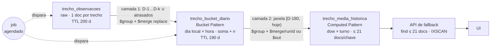

# Agregados em janela móvel no MongoDB — fallback de ETA para frota

POV executável: observações brutas de trechos de uma frota viram, em outra collection,
**médias históricas prontas** por origem, destino, tipo de veículo, dia da semana e turno,
numa janela móvel **D-1 a D-180**, de forma incremental, idempotente e consultável com
uma leitura indexada de no máximo 21 documentos.

> **O modelo de dados desta POV demonstra o padrão; não é proposta de schema produtivo.**
> Cenário genérico (distribuidora de combustíveis com frota), dados 100% sintéticos.

## O problema

Cada viagem é uma rota `base → postos → base`; cada par consecutivo de pontos (trecho)
tem distância e tempo. O ETA é calculado por um serviço externo com trânsito em tempo
real. Quando ele está indisponível, a aplicação precisa de um **fallback offline**: a
média histórica do trecho para aquele tipo de veículo e período do dia, **pré-calculada**,
sem agregar nada no momento da consulta.

O pedido natural é "uma materialized view". Esta POV mostra o equivalente prático no
MongoDB que já existe na solução: resultado materializado em collection + job agendado,
com refresh incremental.

## Arquitetura



1. **Camada 1 (raw → buckets).** Relê só os dias locais D-1…D-k e os dias que receberam
   observação atrasada (detectada pelo watermark de `ingeridoEm`), agrupa por
   trecho × tipo × **dia local × hora local** e grava com `$merge` (`whenMatched:
   "replace"`). Guarda soma e contagem, não média.
2. **Camada 2 (buckets → média).** Recorta a janela semiaberta
   `[00:00 de (asOf − 180), 00:00 de asOf)` no dia local, deriva turno e dia da semana
   da hora do bucket conforme a `config`, agrupa por `{origem, destino, tipoVeiculo, dow,
   turno}` e calcula `mediaMin`/`mediaKm`.
3. **Consulta de fallback.** `find({origem, destino, tipoVeiculo})` pelo índice único,
   ≤ 21 documentos (7 dias × 3 turnos); a aplicação escolhe o nível.

"Toda sexta à noite" é a chave `{dow: 6, turno: "N"}`: a chave **não tem data**, então ela
combina todas as sextas elegíveis da janela.

## Equivalente a uma materialized view do Oracle

| | Oracle MV | Esta POV |
|---|---|---|
| Resultado materializado | segmento da MV | collection `trecho_media_historica` |
| Quem atualiza | `DBMS_MVIEW.REFRESH` / job do scheduler, ou `ON COMMIT` | job da aplicação (`jobs/materializar.py`) chamado por um agendador |
| Janela relativa à data atual | a query usaria `SYSDATE`; expressões não repetíveis como `SYSDATE` tornam a MV **inelegível para fast refresh**, então o refresh seria `COMPLETE` agendado | `asOf` é **parâmetro**; os limites chegam prontos ao pipeline |
| Incremental | fast refresh exige MV log e query elegível | camada 1 incremental (k dias + atrasados); camada 2 recalcula a partir dos **buckets**, não da raw |
| Novo objeto no banco | tabela/MV + aprovação de DDL | collections no MongoDB já existente; sem novo adaptador |

O `$merge` é o mecanismo de escrita do resultado ("on-demand materialized view" na
documentação do MongoDB). Ele **não atualiza nada sozinho**: sem o job, o agregado
envelhece. A comparação acima é de arquitetura, não de desempenho — não medimos Oracle.

## Modelo de dados da POV

Database `frota_eta`. Datas sempre como **BSON Date UTC**; "dia", "hora" e "dia da
semana" são interpretados no fuso `America/Sao_Paulo` dentro do pipeline (operadores com
`timezone`). Toda collection é criada com `$jsonSchema` (`validationLevel: strict`,
`validationAction: error`) por `scripts/bootstrap_db.py` (idempotente).

Documentos abaixo foram extraídos do banco após `make seed PROFILE=small && make job`
(e `make advance`):

**`pontos`** — chave é o código estável do ponto, nunca coordenada GPS bruta.
```js
{ _id: "POSTO-0001", tipo: "posto", nome: "Posto 0001", cidade: "Região Paulínia", uf: "SP",
  location: { type: "Point", coordinates: [ -46.8919, -22.5844 ] } }
```
Em produção a identidade viria do cadastro mestre de bases/postos, com geofence para
associar a posição GPS ao código. Essa decisão é do cliente.

**`tipos_veiculo`**, **`veiculos`**, **`trechos`** (malha direcional, A→B ≠ B→A)
```js
{ _id: "BITREM", descricao: "Bitrem", capacidadeM3: 45, fatorTempo: 1.18 }
{ _id: "VEI-0001", placa: "XED8J55", tipoVeiculo: "TRUCK", baseId: "BASE-001", ativo: true,
  turnoNoturno: false }   // turnoNoturno: só para o gerador
{ _id: "BASE-001|POSTO-0001", origem: "BASE-001", destino: "POSTO-0001",
  distanciaBaseKm: 46.3, tempoBaseMin: 50.5 }
```

**`trecho_observacoes`** (raw) — `observadoEm` é a **partida** do trecho e define hora e
turno (configurável; decisão do cliente).
```js
{ _id: ObjectId("6ad28c12a9abd82b98f5d5c9"), origem: "BASE-001", destino: "POSTO-0001",
  tipoVeiculo: "BITREM", veiculoId: "VEI-0013", viagemId: "VIA-20260410-00021", seq: 1,
  observadoEm: ISODate("2026-04-10T21:57:00.000Z"), ingeridoEm: ISODate("2026-04-10T23:25:44.485Z"),
  distanciaKm: 47.58, tempoMin: 78.68 }
```

**`trecho_bucket_diario`** (camada 1)
```js
{ origem: "BASE-003", destino: "POSTO-0012", tipoVeiculo: "TRUCK",
  dataLocal: ISODate("2026-06-07T03:00:00.000Z"),   // 00:00 de 07/06 em SP
  hora: 8, dowCivil: 1, somaMin: 59.14, somaKm: 24.2, n: 2, minMin: 28.25, maxMin: 30.89,
  atualizadoEm: ISODate("2026-10-16T20:41:57.467Z"), runId: "2026-10-16T20:41:57Z-2427" }
```

**`trecho_media_historica`** (camada 2, o "materialized view")
```js
{ origem: "POSTO-0007", destino: "POSTO-0019", tipoVeiculo: "BITREM", dow: 6, turno: "N",
  somaMin: 131.48, somaKm: 70.22, n: 7, mediaMin: 18.7829, mediaKm: 10.0314,
  janelaInicio: ISODate("2026-04-23T03:00:00.000Z"),   // inclusivo
  janelaFim: ISODate("2026-10-20T03:00:00.000Z"),      // exclusivo = 00:00 de hoje em SP
  asOf: "2026-10-20", configVersao: 1, runId: "2026-10-16T20:51:12Z-509f",
  atualizadoEm: ISODate("2026-10-16T20:51:12.812Z") }
```
(`asOf` 2026-10-20 porque a demo avançou o relógio simulado com `make advance`.)

**`config`** (documento único versionado), **`job_runs`**, **`job_locks`**
```js
{ _id: "ativa", versao: 1, timezone: "America/Sao_Paulo", janelaDias: 180,
  turnos: [ { codigo: "M", inicioHora: 6, fimHora: 12 }, { codigo: "T", inicioHora: 12, fimHora: 18 },
            { codigo: "N", inicioHora: 18, fimHora: 6 } ],
  regraNoite: "dia_civil", kReprocessamento: 3, minAmostras: 5, modoLimpezaCamada2: "out",
  ttlRawDias: 200, ttlBucketDias: 190 }

{ runId: "2026-10-16T20:51:12Z-509f", asOf: "2026-10-20", camada: "todas", status: "ok",
  iniciadoEm: ISODate("2026-10-16T20:51:12.493Z"), finalizadoEm: ISODate("2026-10-16T20:51:15.960Z"),
  stats: { lidos: 1066, inseridos: 358, atualizados: 13796, removidos: 14,
           camada1: { modo: "incremental", lidos: 1066, inseridos: 347, atualizados: 690, removidos: 0,
                      atrasadosDetectados: 12, atrasadosForaDaJanelaK: 0, diasReprocessados: [...],
                      watermarkIngeridoEm: ISODate("2026-10-21T02:53:06.298Z"), pipeline: [...] },
           camada2: { modo: "merge_runid", lidos: 65261, inseridos: 11, atualizados: 13106,
                      removidos: 14, pipeline: [...] } },
  atrasadosForaDaJanelaK: 0, configVersao: 1 }
```
Os contadores de topo somam as duas camadas; o detalhe por camada fica em
`stats.camada1`/`stats.camada2`, junto do pipeline exatamente como foi enviado.

`ingestao_pendente` existe só para a simulação: guarda observações já geradas cujo
`ingeridoEm` ainda está no futuro do relógio da demo; o `advance` as move para a raw
quando elas "chegam".

### Índices e por que cada um existe

| Collection | Índice | Para quê |
|---|---|---|
| `trecho_observacoes` | `{observadoEm: 1}` + TTL 200 d | `$match` de dias da camada 1 e retenção (um índice serve aos dois) |
| | `{ingeridoEm: 1}` | detecção de atrasados: `ingeridoEm ∈ (watermark anterior, watermark novo]` |
| | `{origem, destino, tipoVeiculo, observadoEm}` | consulta on-the-fly na raw (aba 2 e teste de equivalência) |
| | único `{viagemId, seq}` | identidade da observação: reenvio do mesmo trecho da mesma viagem é ignorado (ingestão idempotente) |
| `trecho_bucket_diario` | único `{origem, destino, tipoVeiculo, dataLocal, hora}` | exigido pelo `on` do `$merge` |
| | `{dataLocal: 1}` + TTL 190 d | recorte da janela na camada 2, limpeza de dias reprocessados e retenção |
| `trecho_media_historica` | único `{origem, destino, tipoVeiculo, dow, turno}` | `on` do `$merge` **e** consulta de fallback (prefixo o/d/tipo) |
| `trechos` | único `{origem, destino}` | malha direcional |
| `veiculos` / `pontos` | `{baseId, tipoVeiculo}` / `{tipo}` | catálogo |
| `job_runs` / `job_locks` | `{iniciadoEm: -1}` / TTL `expiraEm` | histórico; lease que expira sozinho |

Os efeitos medidos dos índices estão no explain (aba 2, `docs/consultas.md`) e no
benchmark; não há afirmação de ganho sem medição.

### Retenção e trade-offs

- **Raw: TTL 200 dias** na POV, para a comparação raw × materializado sobre 180 dias ser
  possível. Em produção a raw pode ter TTL curto (ex.: 30 dias), porque os buckets
  carregam o histórico. Trade-off: depois do TTL não dá para reprocessar com outro grão
  nem mudar a regra "partida define o turno".
- **Buckets: TTL 190 dias** (≥ janela + margem). O dia que sai da janela continua nos
  buckets até o TTL; a camada 2 só deixa de lê-lo.
- TTL usa o relógio **real** do servidor. O `advance` da demo move só o relógio simulado,
  então avançar dias não apaga dados.
- **Grão por hora, não por turno**: turnos, dia da semana e blocos de 2 h/4 h são
  derivados depois, **sem reprocessar a raw**. A aba Config prova isso. O custo é medido:
  no perfil `small` cada trecho × tipo é percorrido menos de uma vez por hora por dia, e
  66.927 observações viram 65.277 buckets (compressão quase nula). O ganho da camada 1
  aqui é outro: permitir raw com TTL curto e recalcular a camada 2 sem tocar a raw. Um
  grão mais grosso (turno) compactaria mais e perderia essa flexibilidade.

### Time series collection como alternativa para a raw

Uma time series com `timeField: "observadoEm"` e `metaField: {origem, destino,
tipoVeiculo}` agruparia fisicamente as medições do mesmo trecho/veículo e comprimiria
melhor a raw. Não é o default porque:
- índices secundários e TTL funcionam, mas o TTL de time series expira por bucket
  físico (`expireAfterSeconds` na collection), não por documento;
- `$merge`/`$out` **para** time series têm restrições (a raw é só origem aqui, então isso
  não pesa);
- correções pontuais (update/delete de uma observação) são mais restritas que numa
  collection regular, e o caso "bucket que deixou de existir na raw" depende delas;
- a cardinalidade do `metaField` (trechos × tipos) precisa ser medida antes, como foi
  feito na POV de time series de pagamentos do portfólio.
Vale testar com o volume real do cliente; esta POV não mediu.

## Pipelines

Em `frota/pipelines/`, comentados estágio a estágio, recebendo `asOf` por parâmetro.
Exportados em `docs/pipelines/*.js` (mongosh) e `*.json` (EJSON) por `make pipelines`.

### Por que `whenMatched: "replace"` torna o job idempotente

O bucket de um dia é recalculado **inteiro** a partir da raw daquele dia e substitui o
anterior. Rodar duas vezes grava o mesmo valor. Com `$inc` (ou um pipeline que soma
`$$new.n` ao existente), cada reexecução duplicaria as contagens — o teste de
idempotência falharia. Buckets de dias reprocessados que deixaram de existir na raw
(observação apagada por correção) ficam com `runId` antigo e são removidos por
`deleteMany({dataLocal ∈ dias, runId ≠ atual})` (teste
`test_bucket_que_deixou_de_existir_na_raw_e_removido`).

### Dois modos de limpeza da camada 2

| | `merge_runid` | `out` |
|---|---|---|
| Escrita | `$merge` on chave única, `replace` | `$out` substitui a collection (**default**) |
| Chaves que saíram da janela | `deleteMany({runId ≠ atual})` depois do merge | deixam de existir na troca |
| Visibilidade intermediária | entre o fim do `$merge` e o `deleteMany`, as chaves órfãs continuam visíveis (as válidas já estão atualizadas) | troca atômica: leitores veem a versão antiga ou a nova |
| Índices/validator | preservados | preservados (testado: `test_avanco_de_janela_remove_obsoletos[out]`) |
| Restrições | — | destino não pode ser shardado; reescreve tudo a cada run |
| Custo por run | regrava todas as chaves da janela (`replace`), na collection existente | grava uma collection temporária, constrói os índices e troca |

**Recomendação (com base no benchmark): `out`**, o default. No Atlas M30 a camada 2 levou
43 s com `$out` contra ~170 s com `$merge` + runId, e a troca é atômica para leitores
(testado: leituras contínuas durante o job nunca ficaram sem resposta). `merge_runid` é
a escolha se a collection precisar ser shardada; sua janela de órfãos é curta e
inofensiva para o fallback.

### Hierarquia de fallback (proposta para validação com o cliente)

`dow+turno` (se `n ≥ minAmostras`) → `turno` (soma sobre todos os dias) → `geral` (soma de
tudo do trecho/veículo) → `sem_historico`. Se nenhum nível atingir o mínimo, devolve o
mais amplo com dados e `abaixoDoMinimo: true`. Somar níveis só é correto porque o
agregado guarda `somaMin` e `n`; média de médias seria errado.

```text
GET /eta/fallback?origem=BASE-001&destino=POSTO-0042&tipoVeiculo=BITREM&instante=2026-10-16T20:00:00-03:00&asOf=2026-10-16&minAmostras=3
{"origem":"BASE-001","destino":"POSTO-0042","tipoVeiculo":"BITREM",
 "instanteLocal":"2026-10-16T20:00:00-03:00","chaveSolicitada":{"dow":6,"turno":"N"},
 "nivel":"dow+turno","mediaMin":56.0,"mediaKm":40.0,"n":3,"abaixoDoMinimo":false,"minAmostras":3,
 "janela":{"inicio":"2026-04-19T00:00:00-03:00","fimExclusivo":"2026-10-16T00:00:00-03:00"},
 "asOf":"2026-10-16","configVersao":1,"docsLidos":4}
```

## Compatibilidade de operadores

Executado e testado (90 testes) em **MongoDB 8.0.34** (Docker, replica set de 1 nó) e
**MongoDB 9.0.4** (Atlas M30). As versões mínimas abaixo são as da documentação; outras
versões não foram testadas.

| Operador / recurso | Uso | Disponível desde |
|---|---|---|
| `$dateTrunc` com `timezone` | dia local na camada 1 | 5.0 |
| `$hour`, `$dayOfWeek` com `timezone` | hora local e dow (1 = domingo) | 3.6 (timezone) |
| `$merge` em collection existente, `on` com índice único | camadas 1 e 2 | 4.2 |
| `$out` em collection existente | camada 2, modo `out`; índices e validator preservados (testado) | 2.6 |
| `$switch` | turno a partir da hora | 3.4 |
| `$jsonSchema` validator | todas as collections | 3.6 |
| TTL index | raw, buckets, lock | — |
| `$dateSubtract`, `$setWindowFields` | **não usados**: a janela é calculada em Python com `zoneinfo` e enviada pronta ao pipeline; nenhum cálculo depende de janela por documento | 5.0 |

Diferença conhecida: o validator usa `$jsonSchema` draft 4, em que `exclusiveMinimum` é
booleano (acompanha `minimum`).

## Como rodar

Requisitos: Python 3.12, Node 20+ e um destes alvos MongoDB, escolhidos sozinhos pelo
`.env` (`FROTA_MONGO=auto`):

- **Atlas** — se `MONGODB_URI` estiver preenchida. No portfólio ela vem de
  `PoVs/.env.shared` (`python3 _shared/sync_env.py --apply`); a demo roda no cluster
  compartilhado.
- **Local** — se `MONGODB_URI` estiver vazia (máquina limpa) ou com `FROTA_MONGO=local`:
  `make up` sobe MongoDB 8.0 em Docker na porta 27027 (precisa de ~3 GB livres na VM do
  Docker para o perfil `escala`).

```bash
make up                          # MongoDB 8.0 replica set (porta 27027) + bootstrap + listIndexes
make seed PROFILE=small          # ~74 mil observações, ~2 s
make job                         # camadas 1 e 2 com asOf = hoje em SP
make test                        # pytest contra o MongoDB do docker (banco frota_eta_test)
make api                         # FastAPI em 127.0.0.1:8410 (serve a UI compilada)
make ui                          # Vite em 127.0.0.1:5410 (dev, proxy para 8410)
make ui-build                    # compila a UI para o FastAPI servir
./start.sh                       # tudo junto, no contrato do launcher do portfólio
```

Outros alvos: `make fixtures` (dataset do contrato em `frota_eta_fixtures`), `make job
ASOF=2026-10-16`, `make advance DAYS=1`, `make bench`, `make reset`, `make pipelines`.
`make api DB=frota_eta_fixtures` aponta a UI para as fixtures.

Os alvos que recriam o banco da demo passam `ALLOW_DEMO_DB_WRITE=1`; rodar os scripts
destrutivos à mão contra `frota_eta` é recusado.

Agendamento em produção: um CronJob (Kubernetes), Cloud Scheduler ou equivalente chama
`python jobs/materializar.py` uma vez por dia, depois de 00:00 local. Se o cluster for
Atlas, um Scheduled Trigger pode chamar um endpoint da aplicação que executa o job
(alternativa nativa; não testada nesta POV). Job
concorrente sai com código 3 e fica registrado em `job_runs` com `status: "erro"`.

## Integração com o portfólio

- **Portal** (`pov-portfolio/povs.json`): registrada como `rolling-aggregates`, portas
  5410/8410, `bash start.sh`. O `start.sh` segue o contrato do launcher (primeiro plano,
  derruba a árvore no SIGTERM, tolera porta fechando) — conferido parando o launcher e
  verificando 5410/8410 livres.
- **Portas**: reservadas em `PoVs/PORTS.md` e `check-pov-ports.sh` (5410/8410 e 27027
  do Docker local).
- **Player** (`pov-demo-player`): não registrada. O Player exige réplica gravada por PoV
  (`recordings/<id>`, `demo-config.js`, fixtures e bundle), trabalho próprio, não um
  registro.
- Por padrão a POV usa o cluster compartilhado (`MONGODB_URI` do `.env.shared`); sem ele,
  o MongoDB local em Docker.

## Resultados dos testes

A mesma suíte roda nos dois alvos. Em 2026-10-16:

| Alvo | Versão | Resultado |
|---|---|---|
| Atlas, cluster compartilhado do portfólio (M30, AWS São Paulo) | **MongoDB 9.0.4** | **90 passed in 1661,88 s** (a duração é rede: ~250 ms por ida e volta a partir da máquina de teste) |
| Docker local, replica set de 1 nó | **MongoDB 8.0.34** | **90 passed in 10,3 s** |
| Aceite do zero (volume vazio): `make up && make seed PROFILE=small && make job && make test` | 8.0.34 | passou |

| Arquivo | Testes | Cobre |
|---|---:|---|
| `test_camada1.py` | 7 | buckets por dia/hora local, fuso (23:30 SP), hoje e D-181 fora, soma/contagem/min/max, idempotência, incremental D-1…D-k, bucket que sumiu da raw |
| `test_camada2.py` | 9 | "sexta à noite" combina as 3 sextas, `dia_civil` × `dia_operacional`, 4 bordas da janela, turno e tipo, idempotência, avanço de janela nos **dois** modos de limpeza (validator e índices sobrevivem ao `$out`), turno muda sem tocar buckets |
| `test_atrasos_e_lock.py` | 11 | atrasado D-2 corrige e 3º run não muda nada, atrasado fora de k pelo watermark, watermark vazio no run anterior, job concorrente recusado e registrado, lease vencido retomado, lease perdido para antes de apagar, retomada após falha, retry e contagem certa após escrita parcial, reenvio do mesmo dia não duplica |
| `test_fallback.py` | 16 | contrato 14.4, cada nível da hierarquia, `abaixoDoMinimo`, `sem_historico`, regra da noite no instante, explain IXSCAN ≤ 21, raw == materializado, validators |
| `test_equivalencia.py` | 4 | gerador determinístico; média do agregado == raw em amostra aleatória (seed fixa), `dia_civil`, `dia_operacional` e após avançar 2 dias |
| `test_api.py` | 8 | contrato `/eta/fallback`, contexto derivado, badges derivados, pipeline executado, config reroda só a camada 2 |
| `test_resiliencia.py` | 35 | bateria "visão do cliente" abaixo |

### Bateria "e se…?" (o que um time de operação perguntaria)

| Pergunta | Resposta testada |
|---|---|
| E se mudarmos turnos, regra da noite ou modo de limpeza? | matriz 3 conjuntos de turnos (padrão, 4 blocos sem turno cruzando a meia-noite, noite 20–05) × 2 regras × 2 modos = **12 combinações**: só a camada 2 roda, buckets intactos, agregado == raw |
| E se o fuso tiver horário de verão? | `America/New_York` (dia de 25 h em 01/11/2026): janela em dias de calendário locais (`[2026-05-08T04:00Z, 2026-11-04T05:00Z)`), agregado == raw |
| O fallback fica fora durante o refresh? | leituras contínuas durante 3 jobs, nos dois modos: nenhum erro, nunca `sem_historico` |
| Dois agendadores disparando juntos? | um roda, o outro é recusado; resultado igual a um run único |
| A frota parou / o job ficou meses sem rodar? | janela sem dados esvazia o agregado (os dois modos) e o fallback responde `sem_historico`; job parado 6 dias recupera os 6, não só D-1…D-3 |
| Dado muito atrasado, ou anterior à janela? | 300 atrasados espalhados em 40 dias: todos detectados, agregado == raw; atraso anterior à janela é ignorado |
| Mudaram a config e o job ainda não rodou? | o fallback deriva dow/turno com a **versão da config que gerou o agregado** (histórico em `config_versoes`) e avisa a divergência |
| Duas pessoas editando a config? | a segunda gravação é recusada (versão otimista) |
| Entradas ruins na API? | hora 24, data inválida, instante em texto livre, `minAmostras=0`, turnos sobrepostos, campo não editável, `dias=500`: 4xx, nada alterado |
| E com o banco fora do ar? | API responde 503 com a ação (`make up`) em ~0,5 s; `/health/live` continua 200 |
| Banco vazio? | todas as telas respondem 200; job roda |

### Caos real (`scripts/caos_local.py`, Docker local)

O `mongod` é congelado com `docker pause` no meio da carga inicial:

| Pausa | Consulta durante a pausa | Job | Resultado |
|---|---|---|---|
| 8 s | falha em 1,5 s (`ServerSelectionTimeoutError`), sem pendurar | `ok` em 15,1 s, 1 tentativa (o driver esperou) | idêntico ao run sem falha |
| 20 s (> `serverSelectionTimeoutMS`) | falha em 1,5 s | `ok` em 37,2 s, **2 tentativas** (`_OperationCancelled` na 1ª, retry com backoff) | idêntico ao run sem falha |

### Achados corrigidos durante a validação

- **Soma de ponto flutuante não determinística**: `$sum` de doubles depende da ordem de
  leitura; duas cargas limpas sobre a mesma raw diferiam em 2 de 13.121 chaves por
  5,7e-14. As somas agora são arredondadas a 6 casas no pipeline (micro-minuto); três
  cargas limpas seguidas ficaram idênticas.
- **Contadores do job após retry**: uma tentativa que caía depois de gravar fazia a
  seguinte contar "atualizados" em vez de "inseridos". Plano e contagens "antes" agora são
  congelados uma vez por run; `job_runs` registra `tentativas` e `errosTransitorios`.
- **Watermark vazio** (run anterior com raw vazia) desligava a detecção de atrasos; lease
  sem renovação; `advance` repetido duplicava observações (índice único `{viagemId, seq}`
  + inserção que ignora duplicata); `/api/atrasado` aceitava trecho inexistente.
- **Fallback × config nova sem job**: chave derivada com turnos novos sobre médias antigas.
- **UI**: faltava `data-pov-shell` (faixa em escada e títulos condensados do design system);
  respostas fora de ordem com banco remoto mostravam o contexto do asOf anterior (agora só
  a última resposta vale, e a anterior aparece atenuada enquanto a nova chega); a primeira
  consulta na UI levava 20 s no Atlas (bootstrap e metadados dos badges pela rede) e agora
  leva ~0,54 s — o `start.sh` aquece a API antes de anunciar "pronto".

Observado uma vez e não reproduzido: na rodada completa no Atlas, o teste de banco fora do
ar levou 221 s; isolado, 0,51 s. Coincidiu com o smoke de UI escrevendo no mesmo cluster.

**Dois desvios no contrato 14.1 do enunciado** (os testes validam o valor correto):

1. Com `regraNoite = dia_operacional`, a observação 6 (domingo 19/04 00:00, hora 0 < 6)
   desce para sábado: `{dow: 7, N}` existe com n = 1 e 30 min; quem deixa de existir é
   `{dow: 1, N}`.
2. No avanço para `asOf = 2026-10-17`, a observação 9 (sexta 16/10 00:00:00.000, 999 min)
   também vira D-1: `{dow: 6, N}` fica com n = 5 e somaMin = 2166 (o contrato dizia 4 e 1167).

### UI

`scripts/ui_smoke.py --acoes` (Playwright, opcional) percorre as 6 abas em 1440, 768 e
360 px contra o backend no Atlas, roda job, injeta atraso e avança um dia — sem erro de
console nem overflow horizontal. `bash _shared/ui/check-ui.sh`: cópia de
`pov-signature.css` idêntica à fonte. Latência medida pela UI daqui: `/eta/fallback`
~0,51 s e `/api/eta` ~0,54 s (≈ 2 idas e voltas ao Atlas).

## Benchmark

`make bench` (perfil `escala`: 1.860.697 observações, 2.000 trechos, 1.500 veículos, 200
dias) nos dois alvos, em 2026-10-16. Dados brutos em `docs/bench-results-atlas.json` e
`docs/bench-results-local.json`.

- **Atlas**: cluster compartilhado do portfólio, M30, AWS São Paulo, MongoDB 9.0.4,
  replica set de 3 nós com `w: majority`. Cliente a ~255 ms de ping (p50).
- **Local**: Apple M4 Pro, MongoDB 8.0.34 em Docker com 2 vCPU / 3,8 GiB, 1 nó.

| Medida | Atlas M30 | Local |
|---|---:|---:|
| Carga inicial, camada 1 (1,68 M obs → 1,59 M buckets, `$merge`) | 376,8 s | 169,9 s |
| Carga inicial, camada 2 (→ 164.007 médias, `$merge` + runId) | 35,6 s | 21,4 s |
| Job incremental ao avançar 1 dia (k = 3 + 10 dias com atraso, 120.158 obs) — camada 1 | 135,2 s | 42,4 s |
| idem — camada 2 com `$merge` + runId (1,59 M buckets lidos) | 174,5 s | 26,5 s |
| Job em regime (só k = 3 dias, 27.441 obs) — camada 1 | 31,0 s | não medido |
| idem — camada 2 com `$merge` + runId | 167,8 s | não medido |
| **Camada 2 com `$out`** | **42,9 s** | não medido |
| Recálculo completo direto da raw (`$group` 180 dias + `$out`) | 36,5 s | 12,7 s |
| Fallback no servidor (`executionTimeMillis`, 100 chaves) | p50 0 ms · p95 0 ms · máx 7 ms | — |
| Mesma pergunta na raw, no servidor | p50 3 ms · p95 4 ms · máx 6 ms (191 docs examinados p50, 395 p95, 736 máx) | — |
| Fallback no cliente (500 chaves) | ≈ 1 ping (269 ms p50 vs ping 263 ms) | p50 1,73 ms · p95 3,10 ms |
| Raw on the fly no cliente | p50 261 ms | p50 4,57 ms · p95 14,62 ms |

| Storage no Atlas (`collStats`) | docs | dados | storage | índices |
|---|---:|---:|---:|---:|
| `trecho_observacoes` | 1.869.938 | 423,9 MB | 127,1 MB | 387,5 MB |
| `trecho_bucket_diario` | 1.598.769 | 405,1 MB | 175,5 MB | 230,7 MB |
| `trecho_media_historica` | 163.999 | 51,3 MB | 15,6 MB | 19,1 MB |

**O que os números dizem (e o que mudou por causa deles).**

1. **`$merge` documento a documento é o custo dominante**, e no Atlas (3 nós, `majority`)
   ele pesa mais: a camada 2 com `$merge` + runId levou ~170 s; com `$out`, 43 s. Por isso
   o **default da camada 2 passou a ser `out`** (a especificação original sugeria
   `merge_runid`). `merge_runid` continua disponível para coleção shardada.
2. **Recalcular tudo da raw com `$out` (36,5 s no Atlas) foi mais rápido que o job
   incremental com `$merge`** neste volume. O desenho em duas camadas não ganha em tempo
   de refresh aqui; ganha em retenção (raw com TTL curto), correção de atrasos por dia e
   troca de turno sem tocar a raw. Se esses requisitos não existirem, uma MV com COMPLETE
   refresh (`$out` agendado direto da raw) é uma alternativa legítima e mais simples.
3. **A consulta é o ganho medido**: 0 ms no servidor, 21 documentos, independe do
   histórico do trecho. Na raw são 3 ms e 191–736 documentos examinados — e esse número
   cresce com o volume e com a janela.
4. Visto do cliente, o fallback custa uma ida e volta. Antes ele lia a config a cada
   consulta (2 idas e voltas); agora usa cache de 10 s da config vigente e deriva a chave
   pela versão gravada no próprio agregado.
5. O grão hora quase não compacta neste gerador (1,68 M → 1,59 M); um grão de turno
   compactaria mais e perderia a troca de turno sem reprocessar.

Não medido: camada 1 com grão de turno; tier Atlas dedicado (o cluster é compartilhado
com outras PoVs, o que pode ter afetado tempos); volume real do cliente.

## Limitações

- Testes e benchmark rodaram no Atlas M30 compartilhado (9.0.4) e num MongoDB 8.0 local;
  nada com sharding nem com volume real de cliente. Os perfis `small`/`escala` são
  tamanhos de laboratório. O cluster é compartilhado com outras PoVs: números de tempo
  podem ter sofrido interferência.
- O job incremental foi mais lento que o recálculo completo da raw no benchmark (ver
  "O que os números dizem").
- A camada 2 recalcula a janela inteira a partir dos buckets a cada run (não é
  incremental). É barato porque lê buckets, não raw; um modo incremental (somar o dia que
  entra, subtrair o que sai) é possível porque soma e contagem são componíveis, mas não
  foi implementado.
- Média simples, outliers incluídos. Mediana/percentil não se compõem a partir de soma e
  contagem (ver `docs/decisoes-cliente.md`).
- O relógio da demo é simulado (`asOf`, `ingestao_pendente`); em produção `ingeridoEm` é
  o horário de chegada no servidor.
- O lock é um lease de 30 min, renovado antes de cada camada e de cada `deleteMany`; se o
  lease vencer e outro job assumir, o primeiro para (`LockPerdido`) antes de apagar o que
  o outro gravou. Uma operação única mais longa que o lease ainda pode sobrepor.
- O watermark é `max(ingeridoEm)`. Em produção `ingeridoEm` deve ser carimbado pelo
  servidor na chegada; carimbo do cliente fora de ordem pode esconder atrasos antigos.
- Dois desvios do contrato 14.1 foram encontrados e corrigidos nos testes (ver
  "Resultados dos testes").

## Mais

- [`docs/roteiro-demo.md`](docs/roteiro-demo.md) — roteiro de ~10 min.
- [`docs/decisoes-cliente.md`](docs/decisoes-cliente.md) — decisões pendentes.
- [`docs/consultas.md`](docs/consultas.md) — comandos mongosh com saída real.
- [`docs/briefing/`](docs/briefing/) — arquitetura, consultas e fluxos da UI extraídos do código.
