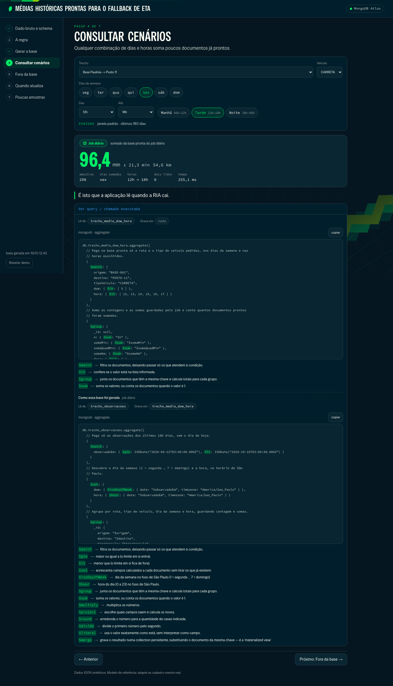
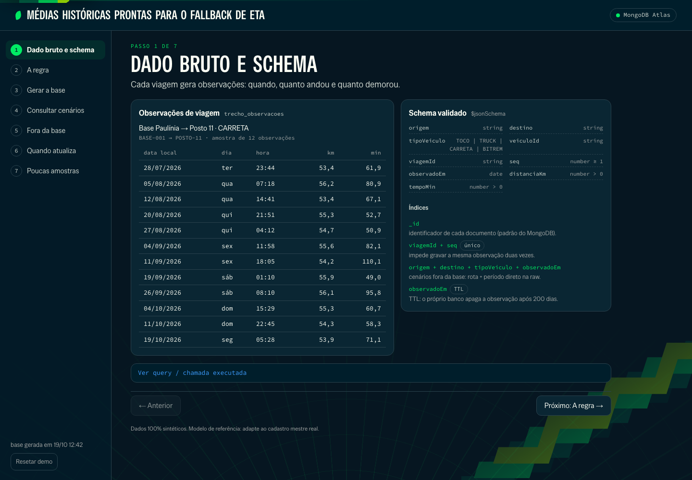
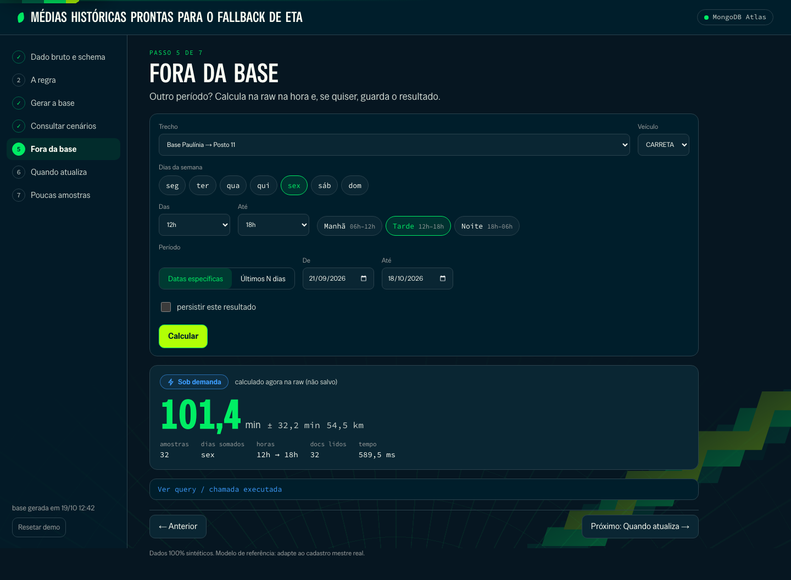
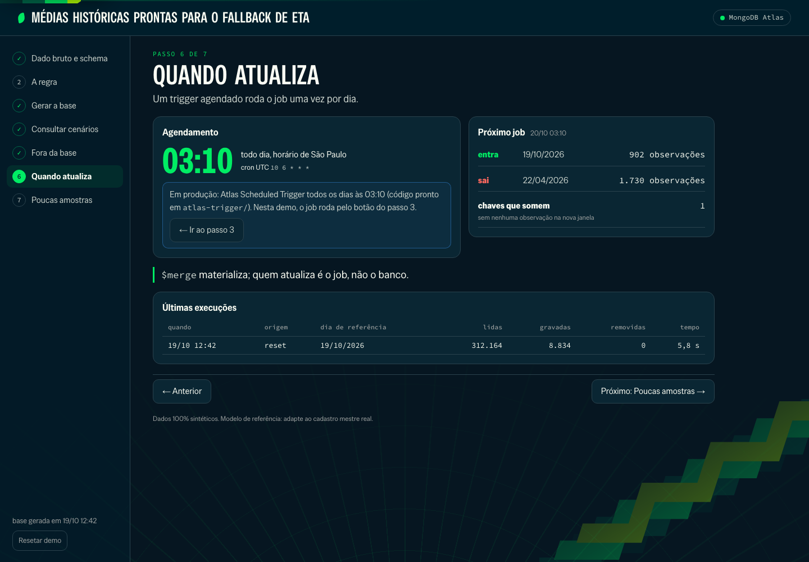
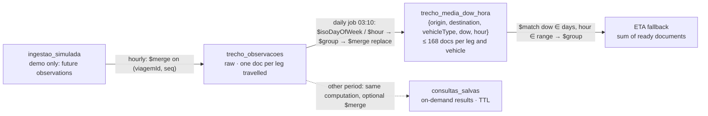

# Rolling-window aggregates on MongoDB: an offline ETA fallback for a fleet

An executable proof of value for one question: **how do raw trip-leg records become
pre-computed averages that answer "every Friday afternoon, this leg, this truck" in
milliseconds, without computing anything at ETA time?** The window is **D-1 to D-180**;
today is always excluded. A daily job materializes the averages with `$merge` (the
"materialized view" MongoDB does not ship as a single object), and any combination of
days of the week, hour range and vehicle type is answered by summing a handful of
ready documents.



> All data is synthetic (a generic fuel distributor with a fleet). **The data model is a
> reference model: adapt it to the real master data** (point codes, vehicle types, trip
> identity). No customer name, cluster hostname, key or connection string is in this
> repository.

## The guided demo: one page, seven steps

The UI is a single page with a step rail on the left, the current step in the centre and
Previous/Next buttons (the rail is also clickable; the URL keeps `#passo=N`). Every step
that runs something has a **"Ver query / chamada executada"** drawer, closed by default:
the collections read and written, the exact command for `mongosh` and one plain sentence
for each operator used.

| # | Step | What it shows | API |
|---|---|---|---|
| 1 | Raw data and schema | 12 observations of one leg and vehicle spread over days and hours; the `$jsonSchema` and the indexes **read from the database**, each with its reason | `GET /api/raw` |
| 2 | The rule | the 180-day window with today's concrete dates, the key (leg × vehicle × day of week × hour), São Paulo time | `GET /api/estado` |
| 3 | Build the base | "Rodar job agora": the job pipeline stage by stage, `$merge` highlighted, counters (read, written, removed, time) | `POST /api/job` |
| 4 | Query scenarios | leg, vehicle, day chips, hour range (Morning 06–12, Afternoon 12–18, Night 18–06), default window; mean ± std dev, km, samples, documents read; badge **"Job diário"** | `POST /api/cenario` |
| 5 | Outside the base | specific dates or "last N days": computed on the raw now; optional **persist** with a validity (TTL); repeating the query reads the saved result; badge **"Sob demanda"** | `POST /api/cenario` |
| 6 | When it refreshes | the schedule (03:10 São Paulo), the last runs from `job_runs` and a read-only preview of tomorrow's job: the day that enters, the day that leaves, keys that would disappear | `GET /api/job_runs`, `GET /api/proximo-job` |
| 7 | Few samples | a deliberately sparse leg: the answer widens step by step and says which level it used, labelled **"rule to validate with the customer"** | `POST /api/cenario` |







More screenshots: [step 3](docs/screenshots/03-gerar-a-base.png) and
[step 7](docs/screenshots/07-poucas-amostras.png).

## How it works



- **The daily job** reads the raw collection in the half-open window
  `[00:00 local of (dataRef − 180), 00:00 local of dataRef)`, derives the ISO day of the
  week (`$isoDayOfWeek`, 1 = Monday … 7 = Sunday) and the hour (`$hour`), both with
  `timezone: "America/Sao_Paulo"`, groups by leg × vehicle × day × hour keeping **count,
  sum, sum of squares and km sum**, and writes with
  `$merge { on: <unique key>, whenMatched: "replace", whenNotMatched: "insert" }`.
  Re-running it gives the same result. Keys that left the window are removed afterwards by
  `atualizadoEm < start of the run`, where the start comes from the **server clock**
  (`hello.localTime`), so two overlapping runs (trigger and button) never delete each
  other's output.
- **`dataRef` is a parameter.** Every window, ingestion and validity function receives the
  reference date or instant; only entrypoints (API, CLI, trigger) read the clock, and
  `$$NOW` is used only for audit fields. The upper bound is always `$lt`.
- **A scenario in the default window** is a `$match` on the unique index plus a `$group`
  over at most 7 × 24 documents. Mean = sum / n; standard deviation =
  √(sum of squares / n − mean²). Hour ranges are half-open: Night 18→06 is hours 18–23
  and 0–5.
- **Any other period** (specific dates, last N days) runs the same computation on the raw
  collection with the compound index `{origem, destino, tipoVeiculo, observadoEm}`. If the
  presenter ticks "persist", `$merge` into `consultas_salvas` is the last stage of the
  same aggregate; the key is a hash of the normalized filter. Absolute periods keep the
  result for 1–30 days (default 7); relative periods expire at the next job. A TTL index on
  `expiraEm` deletes it; reads also filter `expiraEm > now` because the TTL monitor runs
  about once a minute.
- **Few samples** (fewer than 5, only on the ready base): requested days and hours → all
  days of the week at the same hours → the whole day on the requested days → no history.
  The answer names the level. The order is a proposal, not a decision.
- Every collection has a `$jsonSchema` validator (`strict`, `error`) created by an
  idempotent bootstrap; a date sent as a string is rejected.

### Reference data model

| Collection | Role | Key fields | Indexes |
|---|---|---|---|
| `trecho_observacoes` | raw, one document per leg travelled | `origem`, `destino` (stable codes), `tipoVeiculo` (TOCO, TRUCK, CARRETA, BITREM), `veiculoId`, `viagemId`, `seq`, `observadoEm` (departure, UTC), `distanciaKm`, `tempoMin` | `{viagemId, seq}` unique (dedup) · `{origem, destino, tipoVeiculo, observadoEm}` (on-demand) · `{observadoEm}` TTL 200 days (job range + retention) |
| `trecho_media_dow_hora` | the materialized base | key + `n`, `somaMin`, `somaQuadMin`, `somaKm`, `mediaMin`, `mediaKm`, `janelaInicio`, `janelaFim`, `dataRef`, `runId`, `atualizadoEm` | `{origem, destino, tipoVeiculo, dow, hora}` unique (required by `$merge on`) |
| `consultas_salvas` | on-demand results kept for a while | `_id` = filter hash, `filtro`, sums, `periodo` (absolute/relative), `criadoEm`, `expiraEm` | `{expiraEm}` TTL 0 |
| `job_runs` | run history | `origem` (trigger, button, cli, reset), `dataRef`, `status`, counters, masked error | `{iniciadoEm: -1}` |
| `pontos`, `trechos` | lookup for the selects | code → name/city; valid origin/destination pairs | `{origem, destino}` unique on `trechos` |
| `ingestao_simulada` | **demo only**: simulates data arriving, not part of the model | same schema as the raw | `{viagemId, seq}` unique, `{observadoEm}` |

Sums are rounded to 6 decimals so repeated runs are bit-for-bit equal. Median and
percentiles are not used: they do not compose across hours from sum and count.

### Equivalent to an Oracle materialized view

| | Oracle MV | This PoV |
|---|---|---|
| Materialized result | MV segment | `trecho_media_dow_hora` collection |
| Who refreshes it | `DBMS_MVIEW.REFRESH` / scheduler | daily job (Atlas Scheduled Trigger in production; the step-3 button here) |
| Window relative to today | `SYSDATE` makes the MV ineligible for fast refresh, so a scheduled COMPLETE refresh | `dataRef` is a parameter; the limits reach the pipeline already computed |
| Refresh | COMPLETE | `$group` over the window + `$merge` replace (idempotent) |
| New database object | table/MV plus DDL approval | collections in the MongoDB already in the solution |

The comparison is architectural, not a performance claim: Oracle was not measured.

## Scheduling: Atlas Scheduled Triggers

`atlas-trigger/` holds an App Services app in `appservices` CLI format with two Scheduled
Triggers: `jobDiario` (`10 6 * * *` UTC = 03:10 in São Paulo, which has had no daylight
saving time since 2019) and `ingestaoSimulada` (minute 5 of every hour, moves already
"happened" observations from `ingestao_simulada` to the raw collection). Their Functions
are **generated** by `make pipelines` from the same Python builders, and
`tests/test_trigger_export.py` checks that the exported pipeline equals the Python one and
runs the Functions in Node with a fake `context`.

**The triggers are not deployed in this demo.** The deploy needs an Atlas key with Project
Owner on the cluster's project; `make trigger-deploy` stops and explains when the session
lacks it. Without them, step 6 shows the planned schedule and says that, in this demo,
the job runs from the step-3 button. See [`atlas-trigger/README.md`](atlas-trigger/README.md).

## Resetting the demo

"Resetar demo" (bottom of the rail, with a confirmation that shows the click time) rebuilds
`frota_eta` around **the instant of the click**: raw data from D-200 until now, the next
14 days of observations in `ingestao_simulada`, and one job run, with a progress bar. The
route unlocks writes on the demo database only for itself. `make seed` does the same from
the CLI. Without the hourly ingestion trigger, **reset on the morning of the demo** so the
base is built for that day. Locally, `make ingerir` performs one ingestion round by hand.

## Running it

Requirements: Python 3.12, Node 20+ and one MongoDB target, picked from `.env`
(`FROTA_MONGO=auto`):

- **Atlas** when `MONGODB_URI` is set.
- **Local** when it is empty or with `FROTA_MONGO=local`: `make up` starts MongoDB 8.0 in
  Docker on port 27027 (single-node replica set).

```bash
make up        # MongoDB (local only) + collections, validators, indexes
make seed      # rebuild the demo database around now and run the job once
./start.sh     # API 127.0.0.1:8410 + UI 127.0.0.1:5410
make test      # pytest against the target (database frota_eta_test)
```

Also: `make job [DATA=YYYY-MM-DD]`, `make ingerir`, `make pipelines` (regenerates
`docs/pipelines/` and the trigger Functions), `make trigger-deploy`,
`make limpar-atlas [CONFIRMAR=1]`. Destructive scripts refuse the demo database unless
`ALLOW_DEMO_DB_WRITE=1` is set (the `seed` target sets it). API errors never expose the
host, port or URI.

## Tests

The same 87 tests run against both targets (2026-10-19): **MongoDB Atlas 9.0.4** (shared
portfolio cluster) and **local Docker 8.0.34**.

| File | Covers |
|---|---|
| `test_janela.py` | half-open window, today excluded, `$lt`, São Paulo time including a 2018 DST date, hour ranges across midnight, periods, next job |
| `test_job.py` | today excluded, job idempotent, two overlapping runs lose nothing, a key that left the window is removed, `$isoDayOfWeek` at local midnight, rounding, masked errors in `job_runs` |
| `test_cenario.py` | base sum equals direct aggregation on the raw for random scenarios, Night range, every widening level, on-demand compute/persist/read-from-saved/expired, absolute vs relative validity, period without raw data |
| `test_ingestao.py`, `test_previa.py` | ingestion moves only what already happened and never loses arrivals; tomorrow's preview |
| `test_seed.py`, `test_bootstrap.py` | deterministic generator, coverage, sparse legs, reset; validators and indexes read from the database |
| `test_trigger_export.py` | exported trigger pipelines equal the Python ones; Functions run in Node |
| `test_api.py`, `test_operadores.py` | route contracts, the `query` block, 409 during reset, 422 on bad input, 503 without host |

## Limitations

- Tested on a shared Atlas cluster (9.0.4) and local MongoDB 8.0; nothing with sharding or
  with the customer's volume (the demo has ~347 thousand observations over 14 legs).
- The triggers are code-complete and tested offline, but not deployed.
- Simple mean and population standard deviation, outliers included.
- The widening order for few samples and the hour shortcuts are proposals to validate.
- The trigger Function uses a fixed UTC−3 offset; revise it and the cron if daylight saving
  time returns to São Paulo.

## More

Documentation in Portuguese, matching the UI:

- [`docs/visao-tecnica.md`](docs/visao-tecnica.md): data model, indexes, retention, pipelines, compatibility.
- [`docs/roteiro-demo.md`](docs/roteiro-demo.md): the 7-step demo script.
- [`docs/decisoes-cliente.md`](docs/decisoes-cliente.md): decisions to confirm with the customer.
- [`docs/consultas.md`](docs/consultas.md): `mongosh` commands with real output.
- [`docs/pipelines/`](docs/pipelines/): every pipeline, commented, as `.js` and `.json`.
- [`docs/briefing/`](docs/briefing/): architecture, queries and UI flows extracted from the code.
- [`CHANGELOG.md`](CHANGELOG.md).
