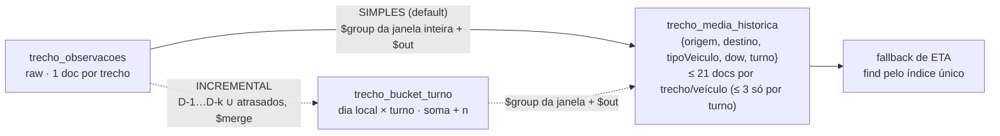

# Visão técnica — agregados em janela móvel (fallback de ETA)

POV executável para a pergunta: **como sair de registros brutos de trechos para médias
pré-calculadas, consultáveis rapidamente por origem, destino, tipo de veículo e período
do dia (manhã/tarde/noite), sem calcular nada na consulta de ETA?** Janela móvel
**D-1 a D-180**, hoje excluído. Dia da semana é uma extensão opcional.

> **O modelo de dados desta POV demonstra o padrão; não é proposta de schema produtivo.**
> Cenário genérico (distribuidora de combustíveis com frota), dados 100% sintéticos.

## O problema

Cada viagem é uma rota `base → postos → base`; cada par consecutivo de pontos (trecho)
tem distância e tempo. O ETA é calculado por um serviço externo com trânsito em tempo
real. Quando ele está indisponível, a aplicação precisa de um **fallback offline**: a
média histórica do trecho para aquele tipo de veículo e período do dia, **pré-calculada**.

O pedido natural é "uma materialized view". A POV mostra o equivalente no MongoDB que já
existe na solução: resultado materializado numa collection, recalculado por um job.

## Arquitetura — dois desenhos, o mesmo resultado



| | **Simples** (default) | **Incremental** (opção para escala) |
|---|---|---|
| Fluxo | raw → `$group` da janela inteira → `$out` | raw → buckets por **turno** (ou hora) → `$out` |
| É o equivalente de | MV com COMPLETE refresh agendado | MV com fast refresh |
| Dado atrasado | entra sozinho no run seguinte (cada run relê os 180 dias) | D-1…D-k + watermark de `ingeridoEm` |
| Mudar turnos | o próximo run já usa | grão turno: refaz a camada 1; grão hora: só a camada 2 |
| Retenção da raw | ≥ 181 dias | pode ser curta (os buckets guardam o histórico) |
| Medido (Atlas M30, 1,86 M obs) | ver [README](../README.md#benchmark) | ver [README](../README.md#benchmark) |

Os dois produzem **exatamente o mesmo agregado** — testado sobre fixtures e dados
sintéticos, com `dia_civil`, `dia_operacional`, com e sem dia da semana, e alternando
modo/grão ao longo dos dias (`tests/test_modos.py`). A aba **Simples × Incremental** da UI
roda os dois sobre a mesma raw e compara.

**Recomendação:** começar pelo simples. É um pipeline, idempotente por natureza (`$out`
troca a collection inteira de forma atômica, preservando índices e validator) e foi o
mais rápido no benchmark. O incremental passa a valer quando a raw precisar de retenção
curta ou quando o volume tornar caro reler 180 dias por dia.

**A consulta de fallback** é igual nos dois: `find({origem, destino, tipoVeiculo})` pelo
índice único, ≤ 21 documentos (7 dias × 3 turnos) ou ≤ 3 só por turno; a aplicação
escolhe o nível. "Toda sexta à noite" é a chave `{dow: 6, turno: "N"}`, sem data.

## Equivalente a uma materialized view do Oracle

| | Oracle MV | Esta POV |
|---|---|---|
| Resultado materializado | segmento da MV | collection `trecho_media_historica` |
| Quem atualiza | `DBMS_MVIEW.REFRESH` / job do scheduler | job da aplicação (`jobs/materializar.py`) chamado por um agendador |
| Janela relativa à data atual | a query usaria `SYSDATE`; expressões não repetíveis como `SYSDATE` tornam a MV **inelegível para fast refresh**, então o refresh seria `COMPLETE` agendado | `asOf` é **parâmetro**; os limites chegam prontos ao pipeline |
| Refresh completo | `COMPLETE` | modo **simples**: `$group` + `$out` |
| Refresh incremental | fast refresh exige MV log e query elegível | modo **incremental**: buckets de k dias + atrasados |
| Novo objeto no banco | tabela/MV + aprovação de DDL | collections no MongoDB já existente; sem novo adaptador |

`$out`/`$merge` são o mecanismo de escrita do resultado ("on-demand materialized view" na
documentação do MongoDB). Eles **não atualizam nada sozinhos**: sem o job, o agregado
envelhece (a resposta do fallback traz `asOf` para detectar isso). A comparação é de
arquitetura, não de desempenho — não medimos Oracle.

## Modelo de dados da POV

Database `frota_eta`. Datas sempre como **BSON Date UTC**; "dia", "hora" e "dia da
semana" são interpretados no fuso `America/Sao_Paulo` dentro do pipeline (operadores com
`timezone`). Toda collection é criada com `$jsonSchema` (`validationLevel: strict`,
`validationAction: error`) por `scripts/bootstrap_db.py` (idempotente).

Documentos abaixo foram extraídos do banco após `make seed PROFILE=small && make job`
(e `make advance`):

**`pontos`** — chave é o código estável do ponto, nunca coordenada GPS bruta.
```js
{ _id: "POSTO-0001", tipo: "posto", nome: "Posto 0001", cidade: "Região Paulínia", uf: "SP",
  location: { type: "Point", coordinates: [ -46.8919, -22.5844 ] } }
```
Em produção a identidade viria do cadastro mestre de bases/postos, com geofence para
associar a posição GPS ao código. Essa decisão é do cliente.

**`tipos_veiculo`**, **`veiculos`**, **`trechos`** (malha direcional, A→B ≠ B→A)
```js
{ _id: "BITREM", descricao: "Bitrem", capacidadeM3: 45, fatorTempo: 1.18 }
{ _id: "VEI-0001", placa: "XED8J55", tipoVeiculo: "TRUCK", baseId: "BASE-001", ativo: true,
  turnoNoturno: false }   // turnoNoturno: só para o gerador
{ _id: "BASE-001|POSTO-0001", origem: "BASE-001", destino: "POSTO-0001",
  distanciaBaseKm: 46.3, tempoBaseMin: 50.5 }
```

**`trecho_observacoes`** (raw) — `observadoEm` é a **partida** do trecho e define hora e
turno (configurável; decisão do cliente).
```js
{ _id: ObjectId("6ad28c12a9abd82b98f5d5c9"), origem: "BASE-001", destino: "POSTO-0001",
  tipoVeiculo: "BITREM", veiculoId: "VEI-0013", viagemId: "VIA-20260410-00021", seq: 1,
  observadoEm: ISODate("2026-04-10T21:57:00.000Z"), ingeridoEm: ISODate("2026-04-10T23:25:44.485Z"),
  distanciaKm: 47.58, tempoMin: 78.68 }
```

**`trecho_bucket_turno`** (modo incremental, grão turno — default do incremental)
```js
{ origem: "POSTO-0011", destino: "BASE-002", tipoVeiculo: "CARRETA",
  dataLocal: ISODate("2026-10-16T03:00:00.000Z"),   // dia local civil (00:00 SP)
  turno: "M", dow: 6, somaMin: 83.26, somaKm: 44.56, n: 2, minMin: 40.65, maxMin: 42.61,
  configVersao: 1, atualizadoEm: ISODate("2026-10-16T23:55:31.050Z"), runId: "2026-10-16T23:55:30Z-1d46" }
```
O `dow` está na chave porque, com `dia_operacional`, o turno N de um dia civil mistura
duas datas de referência (18–23 h do próprio dia e a madrugada, que conta no dia
anterior). Assim cada dia civil é reprocessado sozinho, e a janela segue o mesmo critério
do modo simples. Turno e regra ficam gravados: mudá-los refaz a camada 1.

**`trecho_bucket_diario`** (modo incremental, grão hora — opção para blocos por hora)
```js
{ origem: "BASE-003", destino: "POSTO-0012", tipoVeiculo: "TRUCK",
  dataLocal: ISODate("2026-06-07T03:00:00.000Z"),   // 00:00 de 07/06 em SP
  hora: 8, dowCivil: 1, somaMin: 59.14, somaKm: 24.2, n: 2, minMin: 28.25, maxMin: 30.89,
  atualizadoEm: ISODate("2026-10-16T20:41:57.467Z"), runId: "2026-10-16T20:41:57Z-2427" }
```

**`trecho_media_historica`** (camada 2, o "materialized view")
```js
{ origem: "POSTO-0007", destino: "POSTO-0019", tipoVeiculo: "BITREM", dow: 6, turno: "N",
  somaMin: 131.48, somaKm: 70.22, n: 7, mediaMin: 18.7829, mediaKm: 10.0314,
  janelaInicio: ISODate("2026-04-23T03:00:00.000Z"),   // inclusivo
  janelaFim: ISODate("2026-10-20T03:00:00.000Z"),      // exclusivo = 00:00 de hoje em SP
  asOf: "2026-10-20", configVersao: 1, runId: "2026-10-16T20:51:12Z-509f",
  atualizadoEm: ISODate("2026-10-16T20:51:12.812Z") }
```
(`asOf` 2026-10-20 porque a demo avançou o relógio simulado com `make advance`.)

**`config`** (documento único versionado), **`job_runs`**, **`job_locks`**
```js
{ _id: "ativa", versao: 1, timezone: "America/Sao_Paulo", janelaDias: 180,
  turnos: [ { codigo: "M", inicioHora: 6, fimHora: 12 }, { codigo: "T", inicioHora: 12, fimHora: 18 },
            { codigo: "N", inicioHora: 18, fimHora: 6 } ],
  regraNoite: "dia_civil", kReprocessamento: 3, minAmostras: 5,
  modoMaterializacao: "simples", granularidadeBucket: "turno", incluirDow: true,
  modoLimpezaCamada2: "out", ttlRawDias: 200, ttlBucketDias: 190 }

{ runId: "2026-10-16T20:51:12Z-509f", asOf: "2026-10-20", camada: "todas", status: "ok",
  iniciadoEm: ISODate("2026-10-16T20:51:12.493Z"), finalizadoEm: ISODate("2026-10-16T20:51:15.960Z"),
  stats: { lidos: 1066, inseridos: 358, atualizados: 13796, removidos: 14,
           camada1: { modo: "incremental", lidos: 1066, inseridos: 347, atualizados: 690, removidos: 0,
                      atrasadosDetectados: 12, atrasadosForaDaJanelaK: 0, diasReprocessados: [...],
                      watermarkIngeridoEm: ISODate("2026-10-21T02:53:06.298Z"), pipeline: [...] },
           camada2: { modo: "merge_runid", lidos: 65261, inseridos: 11, atualizados: 13106,
                      removidos: 14, pipeline: [...] } },
  atrasadosForaDaJanelaK: 0, configVersao: 1 }
```
`config_versoes` guarda cada versão da config: o fallback deriva dow/turno com a versão
que gerou o agregado, não com a vigente. Os contadores de topo somam as etapas; o detalhe por camada fica em
`stats.camada1`/`stats.camada2`, junto do pipeline exatamente como foi enviado.

`ingestao_pendente` existe só para a simulação: guarda observações já geradas cujo
`ingeridoEm` ainda está no futuro do relógio da demo; o `advance` as move para a raw
quando elas "chegam".

### Índices e por que cada um existe

| Collection | Índice | Para quê |
|---|---|---|
| `trecho_observacoes` | `{observadoEm: 1}` + TTL 200 d | `$match` de dias da camada 1 e retenção (um índice serve aos dois) |
| | `{ingeridoEm: 1}` | detecção de atrasados: `ingeridoEm ∈ (watermark anterior, watermark novo]` |
| | `{origem, destino, tipoVeiculo, observadoEm}` | consulta on-the-fly na raw (aba 2 e teste de equivalência) |
| | único `{viagemId, seq}` | identidade da observação: reenvio do mesmo trecho da mesma viagem é ignorado (ingestão idempotente) |
| `trecho_bucket_diario` | único `{origem, destino, tipoVeiculo, dataLocal, hora}` | exigido pelo `on` do `$merge` |
| | `{dataLocal: 1}` + TTL 190 d | recorte da janela na camada 2, limpeza de dias reprocessados e retenção |
| `trecho_bucket_turno` | único `{origem, destino, tipoVeiculo, dataLocal, turno, dow}` | `on` do `$merge` da camada 1 por turno |
| | `{dataLocal: 1}` + TTL 190 d | recorte da janela e retenção |
| `trecho_media_historica` | único `{origem, destino, tipoVeiculo, dow, turno}` | `on` do `$merge` **e** consulta de fallback (prefixo o/d/tipo) |
| `trechos` | único `{origem, destino}` | malha direcional |
| `veiculos` / `pontos` | `{baseId, tipoVeiculo}` / `{tipo}` | catálogo |
| `job_runs` / `job_locks` | `{iniciadoEm: -1}` / TTL `expiraEm` | histórico; lease que expira sozinho |

Os efeitos medidos dos índices estão no explain (aba 2, `docs/consultas.md`) e no
benchmark; não há afirmação de ganho sem medição.

### Retenção e trade-offs

- **Modo simples exige raw ≥ 181 dias** (cada run relê a janela inteira). O incremental
  permite raw curta.
- **Raw: TTL 200 dias** na POV, para a comparação raw × materializado sobre 180 dias ser
  possível. Em produção a raw pode ter TTL curto (ex.: 30 dias), porque os buckets
  carregam o histórico. Trade-off: depois do TTL não dá para reprocessar com outro grão
  nem mudar a regra "partida define o turno".
- **Buckets: TTL 190 dias** (≥ janela + margem). O dia que sai da janela continua nos
  buckets até o TTL; a camada 2 só deixa de lê-lo.
- TTL usa o relógio **real** do servidor. O `advance` da demo move só o relógio simulado,
  então avançar dias não apaga dados.
- **Grão por hora, não por turno**: turnos, dia da semana e blocos de 2 h/4 h são
  derivados depois, **sem reprocessar a raw**. A aba Config prova isso. O custo é medido:
  no perfil `small` cada trecho × tipo é percorrido menos de uma vez por hora por dia, e
  66.927 observações viram 65.277 buckets (compressão quase nula). O ganho da camada 1
  aqui é outro: permitir raw com TTL curto e recalcular a camada 2 sem tocar a raw. Um
  grão mais grosso (turno) compactaria mais e perderia essa flexibilidade.

### Time series collection como alternativa para a raw

Uma time series com `timeField: "observadoEm"` e `metaField: {origem, destino,
tipoVeiculo}` agruparia fisicamente as medições do mesmo trecho/veículo e comprimiria
melhor a raw. Não é o default porque:
- índices secundários e TTL funcionam, mas o TTL de time series expira por bucket
  físico (`expireAfterSeconds` na collection), não por documento;
- `$merge`/`$out` **para** time series têm restrições (a raw é só origem aqui, então isso
  não pesa);
- correções pontuais (update/delete de uma observação) são mais restritas que numa
  collection regular, e o caso "bucket que deixou de existir na raw" depende delas;
- a cardinalidade do `metaField` (trechos × tipos) precisa ser medida antes, como foi
  feito na POV de time series de pagamentos do portfólio.
Vale testar com o volume real do cliente; esta POV não mediu.

## Pipelines

**Simples** (`frota/pipelines/simples.py`): `$match` da janela `[início, fim)` →
`$set` hora/dow locais → turno (`$switch` gerado da config) e dow → `$group` por
`{origem, destino, tipoVeiculo, dow, turno}` → médias → `$out`. Seis estágios; é o que
o job roda por padrão. Os demais abaixo são do modo incremental.

Em `frota/pipelines/`, comentados estágio a estágio, recebendo `asOf` por parâmetro.
Exportados em `docs/pipelines/*.js` (mongosh) e `*.json` (EJSON) por `make pipelines`.

### Por que `whenMatched: "replace"` torna o job idempotente

O bucket de um dia é recalculado **inteiro** a partir da raw daquele dia e substitui o
anterior. Rodar duas vezes grava o mesmo valor. Com `$inc` (ou um pipeline que soma
`$$new.n` ao existente), cada reexecução duplicaria as contagens — o teste de
idempotência falharia. Buckets de dias reprocessados que deixaram de existir na raw
(observação apagada por correção) ficam com `runId` antigo e são removidos por
`deleteMany({dataLocal ∈ dias, runId ≠ atual})` (teste
`test_bucket_que_deixou_de_existir_na_raw_e_removido`).

### Dois modos de limpeza da camada 2

| | `merge_runid` | `out` |
|---|---|---|
| Escrita | `$merge` on chave única, `replace` | `$out` substitui a collection (**default**) |
| Chaves que saíram da janela | `deleteMany({runId ≠ atual})` depois do merge | deixam de existir na troca |
| Visibilidade intermediária | entre o fim do `$merge` e o `deleteMany`, as chaves órfãs continuam visíveis (as válidas já estão atualizadas) | troca atômica: leitores veem a versão antiga ou a nova |
| Índices/validator | preservados | preservados (testado: `test_avanco_de_janela_remove_obsoletos[out]`) |
| Restrições | — | destino não pode ser shardado; reescreve tudo a cada run |
| Custo por run | regrava todas as chaves da janela (`replace`), na collection existente | grava uma collection temporária, constrói os índices e troca |

**Recomendação (com base no benchmark): `out`**, o default. No Atlas M30 a camada 2 levou
43 s com `$out` contra ~170 s com `$merge` + runId, e a troca é atômica para leitores
(testado: leituras contínuas durante o job nunca ficaram sem resposta). `merge_runid` é
a escolha se a collection precisar ser shardada; sua janela de órfãos é curta e
inofensiva para o fallback.

### Hierarquia de fallback (proposta para validação com o cliente)

`dow+turno` (se `n ≥ minAmostras`) → `turno` (soma sobre todos os dias) → `geral` (soma de
tudo do trecho/veículo) → `sem_historico`. Se nenhum nível atingir o mínimo, devolve o
mais amplo com dados e `abaixoDoMinimo: true`. Somar níveis só é correto porque o
agregado guarda `somaMin` e `n`; média de médias seria errado.

```text
GET /eta/fallback?origem=BASE-001&destino=POSTO-0042&tipoVeiculo=BITREM&instante=2026-10-16T20:00:00-03:00&asOf=2026-10-16&minAmostras=3
{"origem":"BASE-001","destino":"POSTO-0042","tipoVeiculo":"BITREM",
 "instanteLocal":"2026-10-16T20:00:00-03:00","chaveSolicitada":{"dow":6,"turno":"N"},
 "nivel":"dow+turno","mediaMin":56.0,"mediaKm":40.0,"n":3,"abaixoDoMinimo":false,"minAmostras":3,
 "janela":{"inicio":"2026-04-19T00:00:00-03:00","fimExclusivo":"2026-10-16T00:00:00-03:00"},
 "asOf":"2026-10-16","configVersao":1,"docsLidos":4}
```

## Compatibilidade de operadores

Executado e testado (90 testes) em **MongoDB 8.0.34** (Docker, replica set de 1 nó) e
**MongoDB 9.0.4** (Atlas M30). As versões mínimas abaixo são as da documentação; outras
versões não foram testadas.

| Operador / recurso | Uso | Disponível desde |
|---|---|---|
| `$dateTrunc` com `timezone` | dia local na camada 1 | 5.0 |
| `$hour`, `$dayOfWeek` com `timezone` | hora local e dow (1 = domingo) | 3.6 (timezone) |
| `$merge` em collection existente, `on` com índice único | camadas 1 e 2 | 4.2 |
| `$out` em collection existente | camada 2, modo `out`; índices e validator preservados (testado) | 2.6 |
| `$switch` | turno a partir da hora | 3.4 |
| `$jsonSchema` validator | todas as collections | 3.6 |
| TTL index | raw, buckets, lock | — |
| `$dateSubtract`, `$setWindowFields` | **não usados**: a janela é calculada em Python com `zoneinfo` e enviada pronta ao pipeline; nenhum cálculo depende de janela por documento | 5.0 |

Diferença conhecida: o validator usa `$jsonSchema` draft 4, em que `exclusiveMinimum` é
booleano (acompanha `minimum`).

## Como rodar

Requisitos: Python 3.12, Node 20+ e um destes alvos MongoDB, escolhidos sozinhos pelo
`.env` (`FROTA_MONGO=auto`):

- **Atlas** — se `MONGODB_URI` estiver preenchida. No portfólio ela vem de
  `PoVs/.env.shared` (`python3 _shared/sync_env.py --apply`); a demo roda no cluster
  compartilhado.
- **Local** — se `MONGODB_URI` estiver vazia (máquina limpa) ou com `FROTA_MONGO=local`:
  `make up` sobe MongoDB 8.0 em Docker na porta 27027 (precisa de ~3 GB livres na VM do
  Docker para o perfil `escala`).

```bash
make up                          # MongoDB 8.0 replica set (porta 27027) + bootstrap + listIndexes
make seed PROFILE=small          # ~74 mil observações, ~2 s
make job                         # camadas 1 e 2 com asOf = hoje em SP
make test                        # pytest contra o MongoDB do docker (banco frota_eta_test)
make api                         # FastAPI em 127.0.0.1:8410 (serve a UI compilada)
make ui                          # Vite em 127.0.0.1:5410 (dev, proxy para 8410)
make ui-build                    # compila a UI para o FastAPI servir
./start.sh                       # tudo junto, no contrato do launcher do portfólio
```

Outros alvos: `make fixtures` (dataset do contrato em `frota_eta_fixtures`), `make job
ASOF=2026-10-16`, `make advance DAYS=1`, `make bench`, `make reset`, `make pipelines`.
`make api DB=frota_eta_fixtures` aponta a UI para as fixtures.

Os alvos que recriam o banco da demo passam `ALLOW_DEMO_DB_WRITE=1`; rodar os scripts
destrutivos à mão contra `frota_eta` é recusado.

Agendamento em produção: um CronJob (Kubernetes), Cloud Scheduler ou equivalente chama
`python jobs/materializar.py` uma vez por dia, depois de 00:00 local. Se o cluster for
Atlas, um Scheduled Trigger pode chamar um endpoint da aplicação que executa o job
(alternativa nativa; não testada nesta POV). Job
concorrente sai com código 3 e fica registrado em `job_runs` com `status: "erro"`.

## Integração com o portfólio

- **Portal** (`pov-portfolio/povs.json`): registrada como `rolling-aggregates`, portas
  5410/8410, `bash start.sh`. O `start.sh` segue o contrato do launcher (primeiro plano,
  derruba a árvore no SIGTERM, tolera porta fechando) — conferido parando o launcher e
  verificando 5410/8410 livres.
- **Portas**: reservadas em `PoVs/PORTS.md` e `check-pov-ports.sh` (5410/8410 e 27027
  do Docker local).
- **Player** (`pov-demo-player`): não registrada. O Player exige réplica gravada por PoV
  (`recordings/<id>`, `demo-config.js`, fixtures e bundle), trabalho próprio, não um
  registro.
- Por padrão a POV usa o cluster compartilhado (`MONGODB_URI` do `.env.shared`); sem ele,
  o MongoDB local em Docker.

## Resultados dos testes e benchmark

Números atuais (109 testes no Atlas 9.0.4 e no MongoDB 8.0 local, bateria "e se…?",
caos real e benchmark `escala` dos dois desenhos) estão no [README](../README.md#measured-results).
Dados brutos: `bench-results-atlas.json` (rodada atual), `bench-results-atlas-rodada1.json`
(primeira rodada, camada 2 com `$merge` × `$out`) e `bench-results-local.json`.

Dois desvios no contrato 14.1 do enunciado (os testes validam o valor correto):

1. Com `regraNoite = dia_operacional`, a observação 6 (domingo 19/04 00:00, hora 0 < 6)
   desce para sábado: `{dow: 7, N}` existe com n = 1 e 30 min; quem deixa de existir é
   `{dow: 1, N}`.
2. No avanço para `asOf = 2026-10-17`, a observação 9 (sexta 16/10 00:00:00.000, 999 min)
   também vira D-1: `{dow: 6, N}` fica com n = 5 e somaMin = 2166 (o contrato dizia 4 e 1167).

## Limitações

- Testes e benchmark rodaram no Atlas M30 compartilhado (9.0.4) e num MongoDB 8.0 local;
  nada com sharding nem com volume real de cliente. Os perfis `small`/`escala` são
  tamanhos de laboratório. O cluster é compartilhado com outras PoVs: números de tempo
  podem ter sofrido interferência.
- O job incremental foi mais lento que o recálculo completo da raw no benchmark (ver
  "O que os números dizem").
- A camada 2 recalcula a janela inteira a partir dos buckets a cada run (não é
  incremental). É barato porque lê buckets, não raw; um modo incremental (somar o dia que
  entra, subtrair o que sai) é possível porque soma e contagem são componíveis, mas não
  foi implementado.
- Média simples, outliers incluídos. Mediana/percentil não se compõem a partir de soma e
  contagem (ver `docs/decisoes-cliente.md`).
- O relógio da demo é simulado (`asOf`, `ingestao_pendente`); em produção `ingeridoEm` é
  o horário de chegada no servidor.
- O lock é um lease de 30 min, renovado antes de cada camada e de cada `deleteMany`; se o
  lease vencer e outro job assumir, o primeiro para (`LockPerdido`) antes de apagar o que
  o outro gravou. Uma operação única mais longa que o lease ainda pode sobrepor.
- O watermark é `max(ingeridoEm)`. Em produção `ingeridoEm` deve ser carimbado pelo
  servidor na chegada; carimbo do cliente fora de ordem pode esconder atrasos antigos.
- Dois desvios do contrato 14.1 foram encontrados e corrigidos nos testes (ver
  "Resultados dos testes").

## Mais

- [`roteiro-demo.md`](roteiro-demo.md) — roteiro de ~10 min.
- [`decisoes-cliente.md`](decisoes-cliente.md) — decisões pendentes.
- [`consultas.md`](consultas.md) — comandos mongosh com saída real.
- [`briefing/`](briefing/) — arquitetura, consultas e fluxos da UI extraídos do código.
